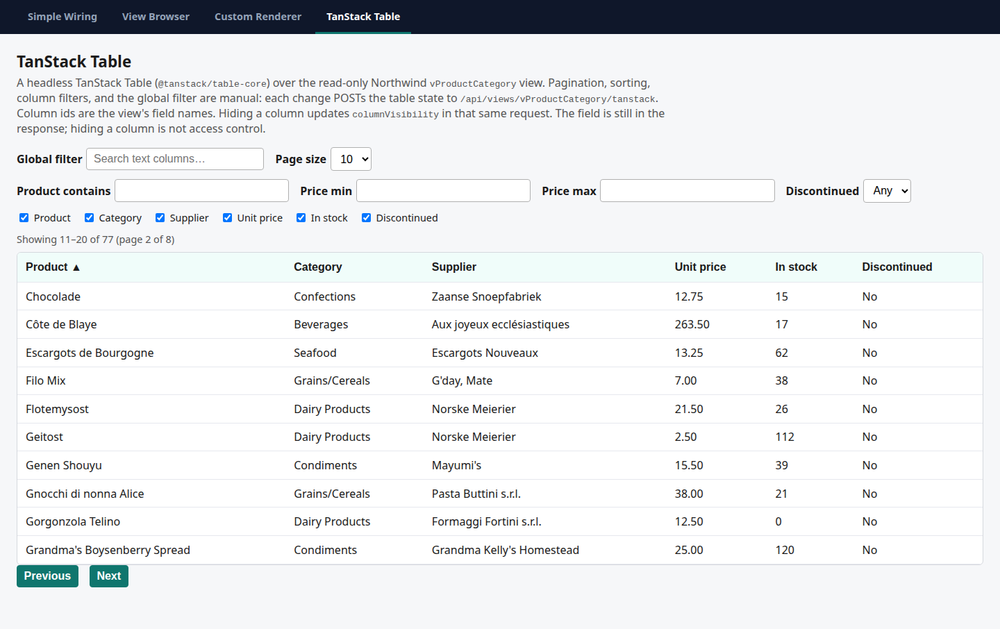
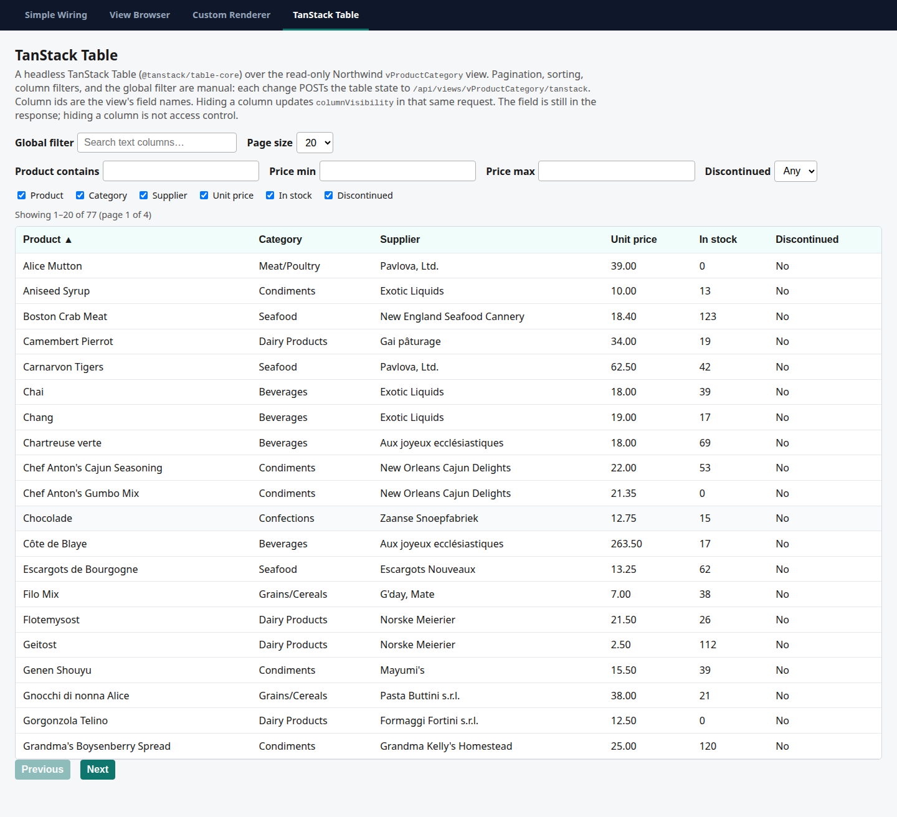
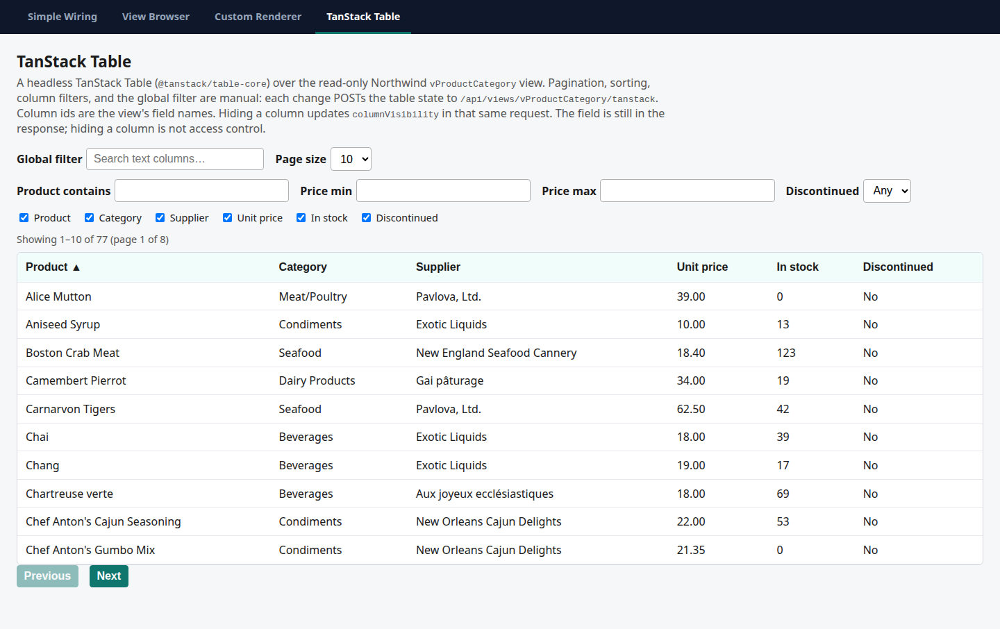
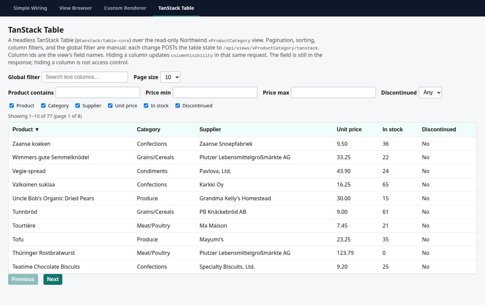
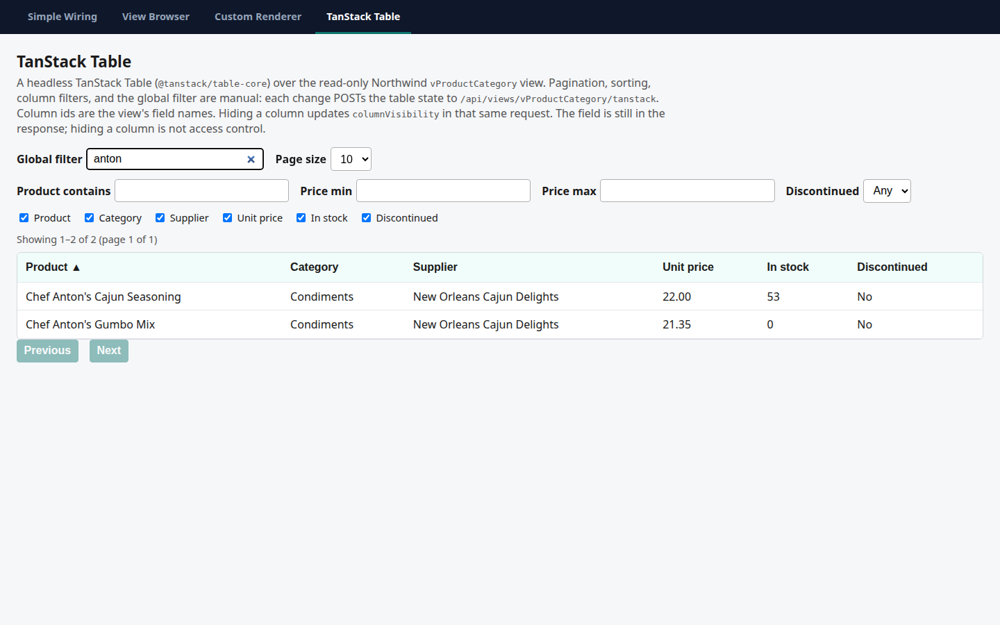
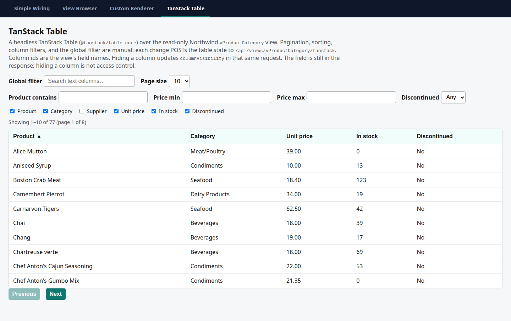

# TanStack showcase smoke — 2026-10-16

Measured on `develop` at `9e3fc24` (merge of PR #10). Host: `a2n.Vista.Examples.AgGridNorthwind` on `http://127.0.0.1:18772`, real `northwind.db`, headless Chromium 153.0.8010.12. Page: `/tanstack.html` (`@tanstack/table-core` 8.21.3 from jsDelivr). No library code was changed.

The same checks are `TanStackShowcaseTests` in `tests/e2e`. Screenshots below were taken by that class with `VISTA_E2E_SCREENSHOT_DIR` set. A following run of the whole Playwright suite (screenshot env unset) was **33 passed, 0 failed, 1 skipped** (34 total; the skip is still `WritableMemoRoundTripTests`).

| Step | Result |
| --- | --- |
| 1. Paging next / previous / page size | Pass |
| 2. Sort `ProductName` ascending then descending | Pass |
| 3. Global filter `anton` shows only matching rows | Pass |
| 4. Hide Supplier in the UI; response still sends `supplierName` | Pass |
| 5. Unknown sort column `notAField` → 400 | Pass |

## 1. Paging — pass

Initial state is page size 10, `ProductName` ascending, 77 rows, 8 pages. First row is Alice Mutton. Status text: `Showing 1–10 of 77 (page 1 of 8)`.


Next moves to `Showing 11–20 of 77 (page 2 of 8)`. The first product is Chocolade, not Alice Mutton.



Previous returns to Alice Mutton and page 1 of 8.


Page size 20 resets to page index 0 and renders 20 rows: `Showing 1–20 of 77 (page 1 of 4)`.



## 2. Sort — pass

The page opens already sorted by Product ascending (`aria-sort="ascending"`), first row Alice Mutton.



One click on the Product header posts `"desc":true`, sets `aria-sort="descending"`, and the first row becomes **Zaanse koeken**.



## 3. Global filter `anton` — pass

`POST /api/views/vProductCategory/tanstack` with `globalFilter` `anton` returned `rowCount` 2:

- Chef Anton's Cajun Seasoning
- Chef Anton's Gumbo Mix

The grid shows those two rows and no others (`Showing 1–2 of 2 (page 1 of 1)`). Alice Mutton is absent.



## 4. Column visibility — pass

Unchecking **Supplier** posts `columnVisibility` with `"SupplierName":false` (the column id, not the header label). The Supplier header leaves the table and each body row has 5 cells.

The same response still includes `supplierName`. First row keys:

`productId, productName, unitPrice, unitsInStock, discontinued, categoryId, categoryName, supplierId, supplierName`

`supplierName` for that first row was `Pavlova, Ltd.` (Alice Mutton). That matches the documented behavior: `columnVisibility` is not access control, and the list executor does not apply `SelectFields`.



## 5. Unknown sort column — pass

Direct `POST /api/views/vProductCategory/tanstack` with `sorting: [{ id: "notAField", desc: false }]`.

HTTP 400:

```json
{
  "type": "urn:a2n.vista:error:filter-unknown-field",
  "title": "Invalid filter",
  "status": 400,
  "detail": "Sort field 'notAField' does not exist in the view projection.",
  "code": "filter-unknown-field",
  "field": "notAField"
}
```

## Bug: Discontinued renders as No for every row

`Products.Discontinued` in `northwind.db` is text `"0"` / `"1"`, and the `Product` CLR property is `string`. Alice Mutton and Chef Anton's Gumbo Mix are both `"1"`.

`wwwroot/js/tanStackTable.js` `cellText` prints Yes only when the value is boolean `true`:

```javascript
if (columnId === 'Discontinued') {
    return value === true ? 'Yes' : 'No';
}
```

A string `"1"` fails that check, so discontinued products show **No**. The filter and page-1 screenshots show Alice Mutton and Chef Anton's Gumbo Mix as No. This is the showcase renderer, not the adapter. Not fixed here.

## Observation

The row JSON also includes `productId`, `categoryId`, and `supplierId`. Those fields are marked `Hidden()` on `vProductCategory`, and spec 01 describes hidden as not sent. The TanStack response is the projection serialized whole, which is the same reason a visibility-hidden `supplierName` is still present. Step 4's expected result (hidden column data still sent) holds.
